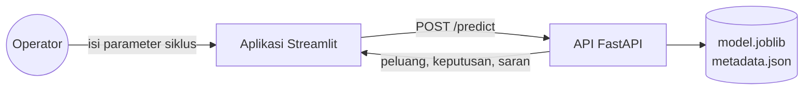

# QC Injection Molding · Peringatan Dini Komponen Cacat

**Kasus:** 01 · Pengendalian Mutu *Injection Molding* · **Aplikasi:** [appapppy-i3hkh8fw4mxexzbfw8nn8x.streamlit.app](https://appapppy-i3hkh8fw4mxexzbfw8nn8x.streamlit.app/) · **Video:** (menyusul)

| Anggota | NIM | Bagian yang dikerjakan |
|---|---|---|
| Farah Aulia Kirana | | Setup dan pembersihan data, fitur, model, evaluasi, dan *threshold* (notebook bagian 1–3 dan 5–10) |
| Naufal Abhirama | | EDA terhadap target (notebook bagian 4), API, aplikasi Streamlit, pengujian, dan *deploy* |

## Masalah dan pengguna

Di pabrik komponen plastik klien, komponen cacat baru ketahuan saat inspeksi visual di akhir shift, sehingga ratusan
komponen bisa telanjur cacat sebelum pengaturan mesin diperbaiki. Aplikasi ini dipakai **operator mesin**: operator
memasukkan bahan, mesin, dan parameter proses dari satu siklus cetak, lalu mendapat peluang komponen itu cacat,
keputusan (pisahkan atau lolos), dan saran tindakan. Komponen berisiko bisa langsung dipisahkan dan pengaturan mesin
bisa segera diperbaiki.

## Cara kerja sistem



Notebook melatih model dan menyimpan `artifacts/model.joblib`, `artifacts/metadata.json`, dan `src/features.py`. API
memuat model, memeriksa masukan, lalu menghitung peluang, keputusan, dan saran. Jika API tidak bisa dihubungi, aplikasi
memuat model sendiri.

## Data dan pembersihan

Data mentah (`data/raw.csv`) berisi 25.350 siklus cetak dari empat mesin selama Maret–Juni 2026, dengan sekitar 8%
komponen cacat. Setelah dibersihkan tersisa 25.000 baris (`data/bersih.csv`).

| Masalah yang ditemukan | Jumlah baris | Cara menangani |
|---|---|---|
| Penulisan `bahan` tidak seragam (`PP `, `P.P`, `pp`, `Abs`, …) | 761 | Dirapikan menjadi PP, ABS, atau PC |
| Penulisan `shift` tidak seragam (`SIANG`, `malam `, `Pagi`) | 506 | Diubah ke huruf kecil dan spasi dihapus |
| Baris duplikat persis | 350 | Dihapus dengan `drop_duplicates` sebelum data dibagi |
| `suhu_leleh_C` IM-04 tercatat dalam °F (10–23 April 2026) | 579 | Dikonversi ke °C dengan (°F − 32) × 5/9 |
| `tekanan_injeksi_bar` = 0 | 125 | Diubah menjadi NaN, lalu diisi median data train di *pipeline* |
| `waktu_siklus_s` = −1 | 75 | Diubah menjadi NaN, lalu diisi median data train di *pipeline* |
| `kelembaban_bahan_pct` kosong | 1.000 | Diisi median data train di *pipeline* |
| `waktu_pendinginan_s` kosong | 250 | Diisi median data train di *pipeline* |
| Nilai ekstrem (IQR per bahan) | 1.725 | Dibiarkan, karena baris ekstrem jauh lebih sering cacat (27% dibanding 6%) |
| Label `shift` tidak cocok dengan jam di `waktu_produksi` | 25.000 | Tidak dipakai sebagai masukan, dan ditanyakan ke klien |

## Hasil

| Model | PR-AUC *validation* | PR-AUC *test* |
|---|---|---|
| *Baseline*: regresi logistik (fitur asli) | 0,474 | 0,529 |
| XGBoost + fitur dari pengetahuan proses (`max_depth` 2) | 0,658 | 0,708 |

Patokan tebak acak: 0,078 (proporsi cacat).

*Threshold* yang dipakai: **0,048**, karena komponen lebih murah disisihkan jika peluang × Rp500.000 (komponen cacat
lolos ke pelanggan) lebih besar daripada (1 − peluang) × Rp25.000 (komponen bagus ikut disisihkan), yaitu jika peluang
> 25.000 / 525.000 ≈ 0,048.

Di data test, model menangkap 352 dari 388 komponen cacat (*recall* 0,91, *precision* 0,28). Total biayanya
Rp40,8 juta, dibanding Rp194 juta jika semua komponen diloloskan seperti sekarang.

## API

| Metode | Path | Kegunaan |
|---|---|---|
| `GET` | `/health` | Cek API hidup dan model termuat |
| `GET` | `/metadata` | Versi model, *threshold*, metrik, dan daftar fitur |
| `POST` | `/predict` | Prediksi satu siklus: peluang cacat, keputusan, dan saran |
| `GET` | `/docs` | Dokumentasi interaktif dan contoh permintaan |

Tekanan, waktu pendinginan, waktu siklus, dan kelembaban boleh dikosongkan. Masukan yang tidak wajar, misalnya suhu
615 °C atau bahan yang tidak dikenal, ditolak dengan kode 422 dan pesan yang menjelaskan kolom yang salah.

## Cara menjalankan

Pakai Python 3.12. Buat dan aktifkan *virtual environment* dari root repositori:

```bash
py -3.12 -m venv .venv                   # Windows (macOS/Linux: python3.12 -m venv .venv)
.venv\Scripts\Activate.ps1               # Windows PowerShell (macOS/Linux: source .venv/bin/activate)
pip install -r requirements-dev.txt      # library aplikasi, notebook, dan pengujian
```

Lalu, masing-masing di terminal sendiri dengan `.venv` aktif:

```bash
python -m uvicorn app.api.main:app --reload       # API di http://127.0.0.1:8000/docs
python -m streamlit run app/ui/streamlit_app.py   # aplikasi di http://localhost:8501
python -m pytest                                  # pengujian
python scripts/cek_model.py                       # cek model di artifacts/ setelah diganti
```

Aplikasi membaca alamat API dari `.streamlit/secrets.toml` (salin dari `secrets.toml.example`). Jika `API_URL`
kosong atau API tidak bisa dihubungi, aplikasi memuat model sendiri (Mode A), sehingga tetap bisa memprediksi.

Notebook `notebooks/qc_injection_molding.ipynb` dijalankan dengan *Restart & Run All*.

## Deploy

Saat ini aplikasi di-deploy ke Streamlit Community Cloud **tanpa API terpisah** (Mode A): aplikasi memuat
`artifacts/model.joblib` sendiri dan memakai validasi, saran, dan peringatan yang sama dengan API.

| Bagian | Layanan | Pengaturan |
|---|---|---|
| Aplikasi | Streamlit Community Cloud | *Main file* `app/ui/streamlit_app.py`, *Advanced settings* → Python 3.12. *Secrets* dikosongkan |
| API (opsional) | Render (*free*) | *New → Blueprint*, pilih repositori ini. Pengaturan ada di `render.yaml`: Python 3.12.10, *build* `pip install -r requirements.txt`, *start* `uvicorn app.api.main:app --host 0.0.0.0 --port $PORT`, *health check* `/health`. Setelah online, isi *Secrets* aplikasi dengan `API_URL = "https://<alamat-api>.onrender.com"` supaya aplikasi memakai API (Mode B) |

Layanan gratis "tidur" jika lama tidak dipakai, sehingga permintaan pertama bisa memakan waktu sampai sekitar satu
menit. Buka aplikasi beberapa menit sebelum demo.

## Struktur repositori

```
notebooks/      notebook dari EDA sampai penyimpanan model
data/           data mentah (raw.csv) dan data bersih (bersih.csv)
src/features.py fungsi pembuat fitur, dipakai saat pelatihan dan saat prediksi
artifacts/      model.joblib + metadata.json
app/api/        API FastAPI: main.py (endpoint), schemas.py (validasi), model.py (memuat model dan prediksi),
                saran.py (aturan saran S1–S8)
app/ui/         aplikasi Streamlit untuk operator
scripts/        model dummy untuk pengujian, dan pemeriksa model di artifacts/
tests/          pengujian otomatis (API, saran, fitur, dan aplikasi)
.streamlit/     contoh pengaturan alamat API
render.yaml     pengaturan deploy API ke Render
docs/PRD.md     dokumen kebutuhan dan pembagian kerja tim
```

## Keterbatasan

- Model hanya berlaku untuk bahan PP, ABS, dan PC serta mesin IM-01 sampai IM-04. Mesin atau bahan baru memerlukan
  data dan pelatihan ulang.
- Data hanya mencakup Maret–Juni 2026. Perubahan kondisi pabrik setelah itu, misalnya cetakan baru atau perawatan mesin,
  belum terwakili.
- Prediksi untuk nilai di luar rentang data latih kurang dapat dipercaya. API memberi peringatan untuk kasus ini.
- Sekitar 3 dari 4 komponen yang disisihkan sebenarnya bagus. Ini disengaja karena komponen cacat yang lolos 20 kali
  lebih mahal, tetapi pabrik perlu siap memeriksa ulang sekitar 25% komponen.
- Model hanya memprediksi cacat atau tidak cacat, bukan jenis cacatnya.
- Data yang belum tersedia dan bisa membantu: riwayat pengeringan bahan, riwayat perawatan mesin (terutama IM-03, yang
  lebih sering cacat karena faktor yang tidak tercatat), jenis dan umur cetakan, serta label shift yang benar.

## Daftar periksa sebelum dikumpulkan

- [x] Repositori bersifat publik dan setiap anggota memiliki *commit*
- [x] *Notebook* dapat dijalankan ulang dari awal sampai akhir tanpa galat
- [x] *Baseline* wajib dilaporkan dan dibandingkan
- [x] Data *test* hanya dibuka satu kali, di akhir
- [x] `artifacts/metadata.json` berisi versi model, fitur masukan, *threshold*, dan metrik
- [ ] Aplikasi dapat dibuka orang lain melalui tautan, termasuk dari ponsel
- [x] Aplikasi tidak berhenti mendadak ketika menerima masukan yang tidak wajar
- [ ] Laporan paling banyak 6 halaman dan video paling lama 5 menit
