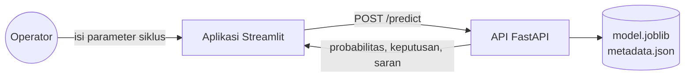

# QC Injection Molding · Peringatan Dini Komponen Cacat

**Kasus 01 · Pengendalian Mutu *Injection Molding*** · Mata kuliah Machine Learning, Semester 5

Sistem ini memprediksi apakah komponen plastik dari satu siklus cetak akan cacat, berdasarkan bahan, mesin, dan
parameter proses. Operator mendapat **probabilitas cacat**, **keputusan** (pisahkan atau lolos), dan **saran
tindakan**, sehingga pengaturan mesin bisa diperbaiki sebelum ratusan komponen telanjur cacat.

| | |
|---|---|
| **Nama proyek** | |
| **Nama tim** | |
| **Aplikasi** | |
| **Dokumentasi API** | |
| **Video** | |
| **Laporan** | |
| **Dokumen kebutuhan (PRD)** | [docs/PRD.md](docs/PRD.md) |

## Daftar isi

- [Tim](#tim)
- [Status pengerjaan](#status-pengerjaan)
- [Masalah dan pengguna](#masalah-dan-pengguna)
- [Cara kerja sistem](#cara-kerja-sistem)
- [Data dan pembersihan](#data-dan-pembersihan)
- [Temuan utama EDA](#temuan-utama-eda)
- [Pendekatan model](#pendekatan-model)
- [Hasil](#hasil)
- [API](#api)
- [Tech stack](#tech-stack)
- [Struktur repositori](#struktur-repositori)
- [Cara menjalankan](#cara-menjalankan)
- [Keterbatasan](#keterbatasan)
- [Pertanyaan untuk klien](#pertanyaan-untuk-klien)
- [Alur kontribusi](#alur-kontribusi)
- [Daftar periksa sebelum dikumpulkan](#daftar-periksa-sebelum-dikumpulkan)

## Tim

| Anggota | NIM | Peran | Bagian yang dikerjakan |
|---|---|---|---|
| Farah Aulia Kirana | | Bagian A · Model | Setup dan pembersihan data (notebook bagian 1–3), fitur, model, evaluasi, *threshold* (bagian 5–10) |
| Naufal Abhirama | | Bagian B · Aplikasi | EDA terhadap target (notebook bagian 4), API, aplikasi Streamlit, pengujian, deploy |

Rincian tanggung jawab dan alur pengerjaan setiap bagian ada di [PRD §13–15](docs/PRD.md#13-pembagian-peran).

## Status pengerjaan

| Tahap | Status |
|---|---|
| Notebook 1 · Setup | ✅ Selesai |
| Notebook 2 · Mengenal data | ✅ Selesai |
| Notebook 3 · Membersihkan data | ✅ Selesai |
| Notebook 4 · EDA terhadap target | ✅ Selesai |
| Notebook 5 · Fitur (`src/features.py`) | ⬜ Belum |
| Notebook 6 · Pembagian data | ⬜ Belum |
| Notebook 7 · *Baseline* regresi logistik | ⬜ Belum |
| Notebook 8 · Model lain | ⬜ Belum |
| Notebook 9 · *Threshold* dan data *test* | ⬜ Belum |
| Notebook 10 · Menyimpan model | ⬜ Belum |
| API (FastAPI) | ⬜ Belum |
| Aplikasi (Streamlit) | ⬜ Belum |
| Pengujian (`pytest`) | ⬜ Belum |
| Deploy | ⬜ Belum |
| Laporan dan video | ⬜ Belum |

## Masalah dan pengguna

Di pabrik komponen plastik klien, komponen cacat baru ketahuan saat inspeksi visual di akhir shift, sehingga ratusan
komponen bisa telanjur cacat sebelum pengaturan mesin diperbaiki. Model ini membantu **operator mesin** di lantai
produksi. Operator memasukkan bahan, mesin, dan parameter proses dari satu siklus cetak, lalu model memberikan
probabilitas bahwa komponen tersebut cacat beserta saran tindakan. Dengan begitu, komponen yang berisiko bisa langsung
dipisahkan dan pengaturan mesin bisa segera diperbaiki.

## Cara kerja sistem



1. Notebook membersihkan data, membuat fitur, melatih model, lalu menyimpan `artifacts/model.joblib`,
   `artifacts/metadata.json`, dan `src/features.py`.
2. API memuat model, memvalidasi masukan, lalu menghitung probabilitas, keputusan, dan saran.
3. Aplikasi Streamlit menyediakan form untuk operator dan menampilkan hasil dari API.

## Data dan pembersihan

Data mentah (`data/raw.csv`) berisi **25.350 siklus cetak** dari empat mesin (IM-01 sampai IM-04) selama Maret sampai
Juni 2026, dengan sekitar **8% komponen cacat**. Setelah dibersihkan tersisa **25.000 baris** (`data/bersih.csv`,
dibuat ulang oleh notebook).

| Kolom | Arti |
|---|---|
| `waktu_produksi` | Waktu siklus cetak |
| `mesin` | IM-01 sampai IM-04 |
| `shift` | pagi, siang, malam |
| `bahan` | Jenis plastik: PP, ABS, atau PC |
| `suhu_leleh_C` | Suhu plastik cair di dalam *barrel* (°C) |
| `suhu_cetakan_C` | Suhu cetakan (°C) |
| `tekanan_injeksi_bar` | Tekanan saat plastik disuntikkan (bar) |
| `kecepatan_injeksi_mm_s` | Kecepatan dorong *screw* (mm/detik) |
| `waktu_pendinginan_s` | Lama komponen didinginkan di dalam cetakan (detik) |
| `waktu_siklus_s` | Lama satu siklus penuh (detik) |
| `kelembaban_bahan_pct` | Kadar air bahan sebelum dicetak (%) |
| `cacat` | **Target**: 1 = cacat, 0 = lolos QC |

| Masalah yang ditemukan | Jumlah baris | Cara menangani |
|---|---|---|
| Penulisan `bahan` tidak seragam (`PP `, `P.P`, `pp`, `Abs`, …) | 761 | Dirapikan menjadi PP, ABS, atau PC |
| Penulisan `shift` tidak seragam (`SIANG`, `malam `, `Pagi`) | 506 | Diubah ke huruf kecil dan spasi dihapus |
| Baris duplikat persis | 350 | Dihapus dengan `drop_duplicates` sebelum data dibagi |
| `suhu_leleh_C` IM-04 tercatat dalam °F (10 sampai 23 April 2026) | 579 | Dikonversi ke °C dengan (°F − 32) × 5/9 |
| `tekanan_injeksi_bar` = 0 | 125 | Diubah menjadi NaN dan diisi median data train di pipeline |
| `waktu_siklus_s` = −1 | 75 | Diubah menjadi NaN dan diisi median data train di pipeline |
| `kelembaban_bahan_pct` kosong | 1.000 | Diisi median data train di pipeline |
| `waktu_pendinginan_s` kosong | 250 | Diisi median data train di pipeline |
| Nilai ekstrem (IQR per bahan) | 1.725 | Dibiarkan karena baris ekstrem jauh lebih sering cacat (27% dibanding 6%) |
| Label `shift` tidak cocok dengan jam di `waktu_produksi` | 25.000 | Tidak dipakai sebagai masukan dan ditanyakan ke klien |

## Temuan utama EDA

| Temuan | Bukti | Dampak |
|---|---|---|
| Cacat berbentuk **U** terhadap selisih suhu dari standar bahan | Sekitar 4% dalam ±5 °C dari standar, sekitar 31% jika lebih dari 20 °C di atas standar | Fitur selisih suhu dan nilai mutlaknya |
| Kelembaban hanya berpengaruh pada **ABS dan PC**, dengan ambang batas | ABS/PC sekitar 3–4% di bawah 0,10%, sekitar 40% di 0,15–0,20%, sekitar 65% di atas 0,20%. PP datar | Fitur kelembaban × higroskopis. Saran pengeringan bahan |
| Tekanan rendah dan pendinginan singkat menaikkan cacat | Tekanan < 760 bar: sekitar 26%. Pendinginan < 13 detik: sekitar 14% | Saran penyesuaian tekanan dan pendinginan |
| **IM-03** sekitar 2× lebih sering cacat | Berjalan sekitar 6 °C lebih panas, dan tetap lebih sering cacat pada suhu yang sama | `mesin` menjadi masukan model. Saran pemeriksaan IM-03 |
| Waktu siklus hanya mengikuti waktu pendinginan | Korelasi 0,89, sisanya tidak berpola | Diperhatikan saat membaca koefisien model |
| Tidak ada tren cacat terhadap waktu | Persentase cacat per minggu stabil | Pembagian data acak dengan stratifikasi |

Suhu standar dari tim proses: PP 230/40 °C, ABS 240/60 °C, PC 300/90 °C (suhu leleh/suhu cetakan).

## Pendekatan model

| Aspek | Keputusan |
|---|---|
| Metrik utama | PR-AUC, karena hanya sekitar 8% komponen yang cacat (akurasi menyesatkan) |
| *Baseline* wajib | Regresi logistik dengan fitur asli |
| Kandidat model | Regresi logistik dengan fitur domain, XGBoost |
| Masukan model | `mesin`, `bahan`, dan 7 parameter proses (`shift` dan `waktu_produksi` tidak dipakai) |
| Pembagian data | *Train*, *validation*, dan *test* 60/20/20 dengan stratifikasi, `random_state = 42` |
| *Threshold* | Biaya termurah di *validation*. Dari brief: komponen cacat yang lolos (FN) Rp500.000, komponen bagus yang disisihkan (FP) Rp25.000 |
| Latih ulang | Model final tidak dilatih ulang dengan *train* + *validation* |
| Data *test* | Dibuka sekali, setelah model dan *threshold* final ditetapkan |

## Hasil

| Model | PR-AUC *validation* | PR-AUC *test* |
|---|---|---|
| *Baseline*: regresi logistik (fitur asli) | | |
| | | |

| | |
|---|---|
| **Model final** | |
| ***Threshold*** | |
| **Alasan *threshold*** | |
| ***Recall* / *precision* (*test*)** | |
| **Versi model** | |

## API

| Metode | Path | Kegunaan |
|---|---|---|
| `GET` | `/health` | Cek API hidup dan model termuat |
| `GET` | `/metadata` | Versi model, *threshold*, metrik, daftar fitur |
| `POST` | `/predict` | Prediksi satu siklus |
| `GET` | `/docs` | Dokumentasi interaktif (Swagger) |

Contoh permintaan:

```json
{
  "mesin": "IM-03",
  "bahan": "ABS",
  "suhu_leleh_C": 262.0,
  "suhu_cetakan_C": 61.5,
  "tekanan_injeksi_bar": 905,
  "kecepatan_injeksi_mm_s": 80.2,
  "waktu_pendinginan_s": 17.5,
  "waktu_siklus_s": 31.0,
  "kelembaban_bahan_pct": 0.18
}
```

Bentuk jawaban:

```json
{
  "probabilitas_cacat": 0.0,
  "keputusan": "PISAHKAN | LOLOS",
  "threshold": 0.0,
  "saran": ["..."],
  "peringatan": ["..."],
  "versi_model": "..."
}
```

`tekanan_injeksi_bar`, `waktu_pendinginan_s`, `waktu_siklus_s`, dan `kelembaban_bahan_pct` boleh dikosongkan.
Masukan yang tidak wajar (misalnya suhu 615 °C atau bahan yang tidak dikenal) ditolak dengan kode 422 dan pesan yang
menjelaskan kolom yang salah. Batas lengkap setiap kolom ada di [PRD §11](docs/PRD.md#11-kontrak-antarmuka).

## Tech stack

| Lapisan | Teknologi | Versi |
|---|---|---|
| Bahasa | Python | 3.12 |
| Olah data | pandas, NumPy | 3.1.0, 2.5.4 |
| Model | scikit-learn, XGBoost (`xgboost-cpu`) | 1.9.1, 3.4.1 |
| Penyimpanan model | joblib | 1.6.0 |
| API | FastAPI, Uvicorn, Pydantic | 0.162.0, 0.54.0, 2.14.1 |
| Aplikasi | Streamlit, requests | 1.66.1, 2.34.2 |
| Notebook dan visualisasi | Jupyter (ipykernel), Matplotlib | — |
| Pengujian | pytest, httpx | — |
| Hosting aplikasi | Streamlit Community Cloud | — |
| Hosting API | | |

Versi library aplikasi dikunci di `requirements.txt` supaya model yang dilatih di notebook memberi hasil yang sama
saat dipakai di aplikasi. Library tambahan untuk notebook dan pengujian ada di `requirements-dev.txt`.

## Struktur repositori

```
qc-injection-molding/
├── data/
│   └── raw.csv                  # data mentah (bersih.csv dibuat ulang oleh notebook)
├── notebooks/
│   └── qc_injection_molding.ipynb  # dari EDA sampai penyimpanan model
├── src/
│   ├── __init__.py
│   └── features.py              # fungsi pembuat fitur, dipakai saat pelatihan dan prediksi
├── artifacts/
│   ├── model.joblib             # pipeline model final
│   └── metadata.json            # versi, fitur, threshold, metrik, versi library
├── app/
│   ├── api/                     # FastAPI: main.py, schemas.py, model.py, saran.py
│   └── ui/
│       └── streamlit_app.py     # aplikasi untuk operator
├── scripts/
│   └── buat_model_dummy.py      # model sementara untuk pengembangan API
├── tests/                       # pytest untuk API, saran, dan fitur
├── docs/
│   └── PRD.md                   # dokumen kebutuhan dan alur pengerjaan
├── .streamlit/
│   └── secrets.toml.example     # contoh konfigurasi URL API
├── requirements.txt             # library aplikasi (dipakai saat deploy)
└── requirements-dev.txt         # library aplikasi + notebook + pengujian
```

Saat ini yang sudah ada: `data/`, `notebooks/`, `src/__init__.py`, `docs/`, dan file `requirements`. Folder lain dibuat
sesuai alur di [PRD §14–15](docs/PRD.md#14-alur-pengerjaan-bagian-a--model).

## Cara menjalankan

### 1. Menyiapkan lingkungan

```bash
git clone https://github.com/FarahAuliaKirana/qc-injection-molding.git
cd qc-injection-molding
python -m venv .venv
```

Aktifkan lingkungan:

```bash
# Windows (PowerShell)
.venv\Scripts\Activate.ps1
# Windows (Command Prompt)
.venv\Scripts\activate.bat
# macOS / Linux
source .venv/bin/activate
```

Lalu pasang library:

```bash
pip install -r requirements-dev.txt
```

### 2. Menjalankan notebook

Buka `notebooks/qc_injection_molding.ipynb` dengan kernel dari `.venv`, lalu jalankan **Restart & Run All**. Notebook
membaca `data/raw.csv` dan menghasilkan `data/bersih.csv`, `src/features.py`, serta isi folder `artifacts/`.

### 3. Menjalankan API dan aplikasi

Jalankan dari root repositori, di dua terminal terpisah:

```bash
uvicorn app.api.main:app --reload       # API di http://127.0.0.1:8000 (dokumentasi: /docs)
streamlit run app/ui/streamlit_app.py   # aplikasi di http://localhost:8501
```

Aplikasi membaca URL API dari `.streamlit/secrets.toml` (salin dari `.streamlit/secrets.toml.example`). Jika file itu
tidak ada, aplikasi memakai `http://127.0.0.1:8000`.

### 4. Menjalankan pengujian

```bash
pytest
```

## Keterbatasan

- Model hanya berlaku untuk bahan PP, ABS, dan PC serta mesin IM-01 sampai IM-04. Mesin atau bahan baru memerlukan
  data dan pelatihan ulang.
- Data hanya mencakup Maret–Juni 2026. Perubahan kondisi pabrik setelah itu, misalnya cetakan baru atau perawatan mesin,
  belum terwakili.
- Prediksi untuk nilai parameter di luar rentang data latih kurang dapat dipercaya. API memberi peringatan untuk kasus
  ini.
- IM-03 lebih sering cacat karena faktor yang tidak tercatat di data. Model hanya bisa menangkapnya sebagai "efek
  mesin", bukan penyebabnya.
- Label `shift` tidak cocok dengan jam produksi, sehingga pengaruh shift atau jam kerja tidak bisa dianalisis dengan
  andal.
- Model hanya memprediksi cacat atau tidak cacat, bukan jenis cacatnya.

## Pertanyaan untuk klien

1. Mana yang benar untuk menentukan shift: label `shift` atau jam di `waktu_produksi`?
2. Apakah ada perbedaan kondisi fisik atau *setting* pemanas di IM-03 dibandingkan mesin lain?
3. Apakah sensor IM-04 memang pernah diatur ke satuan °F pada 10–23 April 2026?
4. Berapa biaya satu komponen cacat yang lolos ke pelanggan dibandingkan satu komponen bagus yang dibuang?

## Alur kontribusi

- Kerja langsung di `main`. Perubahan yang menyangkut bagian orang lain dibicarakan dulu, baru di-push.
- Selalu `git pull` sebelum mulai kerja dan sebelum push.
- Setelah bagian 4, notebook hanya diubah oleh pemilik Bagian A supaya tidak terjadi konflik.
- `artifacts/` wajib di-commit. `data/bersih.csv`, `.venv/`, `artifacts_dummy/`, dan `.streamlit/secrets.toml` tidak
  di-commit.

Aturan lengkap ada di [PRD §17](docs/PRD.md#17-alur-kerja-git).

## Daftar periksa sebelum dikumpulkan

- [ ] Repositori bersifat publik dan setiap anggota memiliki *commit*
- [ ] *Notebook* dapat dijalankan ulang dari awal sampai akhir tanpa galat
- [ ] *Baseline* wajib dilaporkan dan dibandingkan
- [ ] Data *test* hanya dibuka satu kali, di akhir
- [ ] `artifacts/metadata.json` berisi versi model, fitur masukan, *threshold*, dan metrik
- [ ] Aplikasi dapat dibuka orang lain melalui tautan, termasuk dari ponsel
- [ ] Aplikasi tidak berhenti mendadak ketika menerima masukan yang tidak wajar
- [ ] Laporan paling banyak 6 halaman dan video paling lama 5 menit
