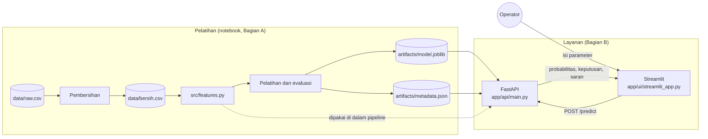
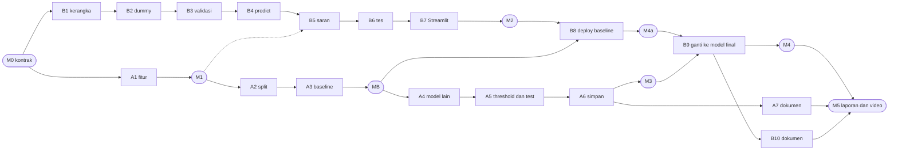

# PRD · Sistem Peringatan Dini Cacat *Injection Molding*

| | |
|---|---|
| **Kasus** | 01 · Pengendalian Mutu *Injection Molding* |
| **Repositori** | [FarahAuliaKirana/qc-injection-molding](https://github.com/FarahAuliaKirana/qc-injection-molding) |
| **Tim** | Farah Aulia Kirana (Bagian A · Model) · Naufal Abhirama (Bagian B · Aplikasi) |
| **Status dokumen** | Draf v2. Notebook bagian 1–4 selesai, bagian 5–10 dan aplikasi belum dimulai |
| **Terakhir diperbarui** | 20 November 2026 |

Dokumen ini adalah acuan bersama tim: apa yang dibangun, untuk siapa, bagaimana bagian-bagiannya saling terhubung,
dan urutan pengerjaannya. Jika ada keputusan yang berubah, perbarui dokumen ini lebih dulu, baru kodenya.

## Daftar isi

1. [Ringkasan](#1-ringkasan)
2. [Latar belakang dan masalah](#2-latar-belakang-dan-masalah)
3. [Tujuan dan non-tujuan](#3-tujuan-dan-non-tujuan)
4. [Pengguna dan skenario pemakaian](#4-pengguna-dan-skenario-pemakaian)
5. [Ruang lingkup](#5-ruang-lingkup)
6. [Kebutuhan fungsional](#6-kebutuhan-fungsional)
7. [Kebutuhan non-fungsional](#7-kebutuhan-non-fungsional)
8. [Data](#8-data)
9. [Pendekatan model](#9-pendekatan-model)
10. [Arsitektur sistem](#10-arsitektur-sistem)
11. [Kontrak antarmuka](#11-kontrak-antarmuka)
12. [Aturan saran tindakan](#12-aturan-saran-tindakan)
13. [Pembagian peran](#13-pembagian-peran)
14. [Alur pengerjaan Bagian A · Model](#14-alur-pengerjaan-bagian-a--model)
15. [Alur pengerjaan Bagian B · Aplikasi](#15-alur-pengerjaan-bagian-b--aplikasi)
16. [Titik sinkronisasi](#16-titik-sinkronisasi)
17. [Alur kerja Git](#17-alur-kerja-git)
18. [Pengujian dan kriteria penerimaan](#18-pengujian-dan-kriteria-penerimaan)
19. [Laporan dan video](#19-laporan-dan-video)
20. [Risiko dan mitigasi](#20-risiko-dan-mitigasi)
21. [Keputusan](#21-keputusan)
22. [Glosarium](#22-glosarium)

---

## 1. Ringkasan

Pabrik komponen plastik klien baru mengetahui komponen cacat saat inspeksi visual di akhir shift. Kami membangun
sistem yang menerima parameter dari **satu siklus cetak** (bahan, mesin, dan parameter proses), lalu mengembalikan
**probabilitas komponen tersebut cacat**, **keputusan** (pisahkan atau lolos) berdasarkan *threshold* yang dipilih
dari pertimbangan biaya, serta **saran tindakan** yang bisa langsung dikerjakan operator.

Sistem terdiri dari tiga lapis:

1. **Notebook** untuk EDA, pembersihan data, pembuatan fitur, pelatihan, dan evaluasi model. Hasilnya
   `src/features.py`, `artifacts/model.joblib`, dan `artifacts/metadata.json`.
2. **API (FastAPI)** yang memuat model, memvalidasi masukan, dan menghitung prediksi serta saran.
3. **Aplikasi web (Streamlit)** untuk operator. Aplikasi ini memanggil API dan bisa dibuka dari ponsel. Kalau API sedang
   tidak bisa dihubungi, aplikasi memakai model secara langsung.

## 2. Latar belakang dan masalah

- Inspeksi visual hanya dilakukan di akhir shift. Jika pengaturan mesin menyimpang di awal shift, ratusan komponen
  bisa telanjur cacat sebelum ada yang sadar.
- Operator sebenarnya sudah melihat parameter proses di panel mesin setiap siklus, tetapi tidak punya cara cepat
  untuk menilai apakah kombinasi parameter itu berisiko.
- Data historis tersedia: 25.350 siklus dari empat mesin (IM-01 sampai IM-04) selama Maret–Juni 2026, dengan sekitar
  8% komponen cacat. Data diekspor apa adanya dan berisi banyak masalah kualitas (lihat [§8](#8-data)).

## 3. Tujuan dan non-tujuan

### Tujuan

| Kode | Tujuan | Ukuran keberhasilan |
|---|---|---|
| G1 | Model mampu membedakan siklus berisiko cacat dari siklus normal | PR-AUC *test* jauh di atas proporsi cacat (sekitar 0,08), dan lebih tinggi dari *baseline* regresi logistik |
| G2 | Keputusan "pisahkan atau lolos" mempertimbangkan biaya nyata | *Threshold* dipilih dari biaya di brief (FN Rp500.000, FP Rp25.000), dengan alasan tertulis |
| G3 | Operator bisa memakai sistem langsung di lantai produksi | Aplikasi bisa dibuka lewat tautan, termasuk dari ponsel, dan memberi jawaban dalam hitungan detik |
| G4 | Sistem tahan terhadap masukan yang tidak wajar | Tidak ada masukan yang membuat API atau aplikasi berhenti mendadak |
| G5 | Hasil bisa diulang dan diperiksa | Notebook bisa dijalankan ulang dari awal tanpa galat, dan versi library dikunci |

### Non-tujuan

- Tidak menghubungkan sistem langsung ke PLC atau sensor mesin. Masukan diisi manual oleh operator.
- Tidak mendeteksi **jenis** cacat, karena data hanya berisi label cacat atau tidak cacat.
- Tidak menyediakan login, akun pengguna, atau penyimpanan riwayat prediksi.
- Tidak memakai kolom `shift` dan `waktu_produksi` sebagai masukan model (lihat [§8](#8-data)).
- Tidak mendukung bahan selain PP, ABS, dan PC, atau mesin selain IM-01 sampai IM-04.

## 4. Pengguna dan skenario pemakaian

| Pengguna | Kebutuhan | Cara memakai sistem |
|---|---|---|
| **Operator mesin** (pengguna utama) | Tahu dengan cepat apakah siklus yang baru selesai berisiko, dan apa yang harus diubah | Membuka aplikasi di ponsel atau PC di dekat mesin, mengisi parameter, lalu membaca keputusan dan saran |
| **Kepala QC** (klien) | Mengurangi komponen cacat yang lolos dan memahami penyebab cacat | Membaca laporan, termasuk temuan EDA dan saran perbaikan per mesin |
| **Dosen dan penilai** | Memeriksa kebenaran metode dan kelengkapan | Membaca README, notebook, laporan, dan video, serta mencoba aplikasi |

### Cerita pengguna

| Kode | Sebagai … | Saya ingin … | Supaya … |
|---|---|---|---|
| US-01 | operator | memasukkan parameter satu siklus dan langsung melihat probabilitas cacat | bisa memisahkan komponen berisiko sebelum tercampur |
| US-02 | operator | melihat saran tindakan yang spesifik, misalnya "keringkan bahan" | tahu pengaturan mana yang harus diperbaiki |
| US-03 | operator | tetap mendapat prediksi walaupun kelembaban bahan belum diukur | tidak terhambat oleh data yang belum tersedia |
| US-04 | operator | mendapat pesan yang jelas saat salah ketik, misalnya suhu 615 | bisa langsung memperbaiki masukan |
| US-05 | operator | memakai aplikasi dari ponsel | tidak perlu meninggalkan mesin |
| US-06 | kepala QC | mengetahui faktor yang paling sering menyebabkan cacat | bisa memperbaiki prosedur produksi |
| US-07 | penilai | menjalankan ulang notebook dan aplikasi dari README | bisa memverifikasi hasil |

## 5. Ruang lingkup

| Termasuk | Tidak termasuk |
|---|---|
| Pembersihan data, EDA, fitur, pelatihan, dan evaluasi di notebook | *Retraining* otomatis |
| Model klasifikasi biner (cacat atau lolos) beserta probabilitasnya | Klasifikasi jenis cacat |
| API prediksi satu siklus (`POST /predict`) | Prediksi *batch* dari unggahan file (opsional jika waktu tersisa) |
| Aplikasi Streamlit untuk operator | Aplikasi mobile *native* |
| Saran tindakan berbasis aturan dari temuan EDA | Optimasi parameter otomatis |
| Deploy publik API dan aplikasi | Autentikasi dan basis data |
| README, laporan (maks. 6 halaman), dan video (maks. 5 menit) | |

## 6. Kebutuhan fungsional

| Kode | Kebutuhan | Pemilik |
|---|---|---|
| FR-01 | Notebook membaca `data/raw.csv`, membersihkannya, lalu menyimpan `data/bersih.csv` | A (selesai) |
| FR-02 | `src/features.py` menyediakan fungsi pembuat fitur yang dipakai saat pelatihan dan saat prediksi | A |
| FR-03 | Notebook melatih *baseline* wajib berupa regresi logistik dengan fitur asli dan melaporkan PR-AUC *validation* | A |
| FR-04 | Notebook membandingkan minimal satu model lain dengan *baseline* menggunakan PR-AUC *validation* | A |
| FR-05 | *Threshold* dipilih dari biaya FN dan FP pada data *validation*. Data *test* dibuka sekali, setelah *threshold* ditetapkan | A |
| FR-06 | Model final disimpan sebagai `artifacts/model.joblib` beserta `artifacts/metadata.json` ([§11.6–11.7](#116-artifactsmodeljoblib)) | A |
| FR-07 | API menyediakan `GET /health`, `GET /metadata`, dan `POST /predict` ([§11.3](#113-endpoint)) | B |
| FR-08 | API memvalidasi masukan: tipe, batas fisik, nilai kategori, dan logika antarkolom ([§11.1](#111-skema-masukan)) | B |
| FR-09 | API menormalkan penulisan kategori, misalnya `pp`, `P.P`, `PP ` menjadi `PP`, dan `im-01` menjadi `IM-01` | B |
| FR-10 | API menerima nilai kosong untuk kolom opsional dan menambahkan peringatan bahwa prediksi kurang akurat | B |
| FR-11 | API memberi peringatan jika ada nilai di luar rentang data latih (prediksi tetap dikembalikan) | B |
| FR-12 | API menghasilkan saran tindakan sesuai [§12](#12-aturan-saran-tindakan) | B |
| FR-13 | Aplikasi Streamlit menampilkan form masukan, probabilitas, keputusan, saran, dan peringatan | B |
| FR-14 | Aplikasi mengisi nilai awal suhu sesuai standar bahan yang dipilih | B |
| FR-15 | Aplikasi menampilkan pesan yang ramah jika API lambat, mati, atau menolak masukan | B |
| FR-16 | Setiap prediksi dicatat ke log (masukan, hasil, dan waktunya) | B |
| FR-17 | Kalau API tidak bisa dihubungi, aplikasi tetap bisa memprediksi dengan memuat model sendiri | B |

## 7. Kebutuhan non-fungsional

| Kode | Kebutuhan |
|---|---|
| NFR-01 | **Ketahanan.** Tidak ada masukan yang menghasilkan galat 500 atau membuat aplikasi berhenti. Semua kesalahan masukan dijawab dengan kode 422 dan pesan berbahasa Indonesia. |
| NFR-02 | **Konsistensi.** Semua memakai Python 3.12. Versi library di lingkungan pelatihan, API, dan deploy sama dengan `requirements.txt`, dan versi Python serta library dicatat di `metadata.json`. |
| NFR-03 | **Tanpa kebocoran data.** Duplikat dihapus sebelum *split*. Imputasi dan *scaling* dipelajari hanya dari data *train* di dalam *pipeline*. |
| NFR-04 | **Reproduksibilitas.** `RANDOM_STATE = 42`. Notebook bisa dijalankan ulang dari awal sampai akhir dengan kernel `.venv`. |
| NFR-05 | **Kecepatan.** Satu prediksi selesai dalam waktu kurang dari 1 detik di sisi API (di luar *cold start* hosting gratis). |
| NFR-06 | **Aksesibilitas.** Aplikasi nyaman dipakai di layar ponsel (satu kolom, tombol cukup besar, angka mudah dibaca). |
| NFR-07 | **Keterbacaan.** Kode dan dokumen memakai bahasa Indonesia yang konsisten dengan notebook. |
| NFR-08 | **Keamanan dasar.** URL API disimpan di `st.secrets`, bukan di dalam kode. `secrets.toml` tidak di-commit. |

## 8. Data

### Sumber

`data/raw.csv` berisi 25.350 baris dan 12 kolom. Satu baris adalah satu siklus cetak. Target berupa `cacat`
(1 = cacat). Setelah dibersihkan menjadi 25.000 baris dengan proporsi cacat 7,8%.

### Ringkasan pembersihan (notebook bagian 3)

| Masalah | Baris | Penanganan |
|---|---|---|
| Penulisan `bahan` dan `shift` tidak seragam | 761 dan 506 | Diseragamkan |
| Baris duplikat persis | 350 | Dihapus sebelum *split* |
| `suhu_leleh_C` IM-04 tercatat dalam °F (10–23 April 2026) | 579 | Dikonversi ke °C |
| `tekanan_injeksi_bar` = 0 dan `waktu_siklus_s` = −1 | 125 dan 75 | Diubah menjadi NaN, diisi di *pipeline* |
| `kelembaban_bahan_pct` dan `waktu_pendinginan_s` kosong | 1.000 dan 250 | Diisi di *pipeline* |
| Nilai ekstrem (IQR per bahan) | 1.725 | Dibiarkan karena merupakan sinyal cacat |
| Label `shift` tidak cocok dengan jam produksi | 25.000 | Tidak dipakai sebagai masukan, ditanyakan ke klien |

### Temuan EDA yang mengarahkan desain (notebook bagian 4)

| Temuan | Dampak pada desain |
|---|---|
| Cacat berbentuk **U** terhadap selisih suhu leleh dan suhu cetakan dari standar bahan (sekitar 4% dalam ±5 °C, sekitar 31% di atas +20 °C) | Fitur selisih suhu dan nilai mutlaknya. Aturan saran suhu |
| Kelembaban hanya berpengaruh pada ABS dan PC, dengan ambang sekitar 0,10–0,15% (di atas 0,20%, sekitar 65% cacat) | Fitur kelembaban × higroskopis. Imputasi kelembaban per bahan. Aturan saran pengeringan |
| Tekanan di bawah sekitar 760 bar menaikkan cacat menjadi sekitar 26%. Tekanan tinggi tidak bermasalah | Fitur kekurangan tekanan. Aturan saran tekanan |
| Pendinginan di bawah sekitar 13 detik menaikkan cacat menjadi sekitar 14% | Aturan saran pendinginan |
| Waktu siklus hanya mengikuti waktu pendinginan (korelasi 0,89) | Hati-hati membaca koefisien regresi logistik |
| IM-03 sekitar 2× lebih sering cacat, berjalan sekitar 6 °C lebih panas, dan tetap lebih sering cacat pada suhu yang sama | `mesin` menjadi masukan model. Saran khusus IM-03 |
| Tidak ada tren cacat terhadap waktu | *Split* acak dengan stratifikasi dapat dipakai |

### Konstanta domain (dari brief)

| Bahan | Suhu leleh standar | Suhu cetakan standar | Menyerap air |
|---|---|---|---|
| PP | 230 °C | 40 °C | Tidak |
| ABS | 240 °C | 60 °C | Ya |
| PC | 300 °C | 90 °C | Ya |

## 9. Pendekatan model

| Aspek | Keputusan |
|---|---|
| Jenis tugas | Klasifikasi biner dengan probabilitas |
| Metrik utama | **PR-AUC** (*average precision*), karena data tidak seimbang. Akurasi tidak dipakai |
| Metrik pendukung | *Recall* dan *precision* pada *threshold* terpilih, *confusion matrix*, total biaya |
| Pembagian data | 60/20/20 untuk *train*, *validation*, dan *test*, dengan stratifikasi pada `cacat` dan `random_state = 42`. Dengan proporsi ini, *validation* dan *test* masing-masing berisi sekitar 388 komponen cacat |
| *Baseline* wajib | Regresi logistik dengan fitur asli dalam satu `Pipeline` (imputasi median, *scaling*, *one-hot*) |
| Kandidat model | Regresi logistik dengan fitur dari `src/features.py`, XGBoost, dan model lain bila perlu |
| Pemilihan model | PR-AUC *validation* tertinggi. Kalau hasilnya hampir sama (selisih di bawah 0,01), pilih regresi logistik karena lebih mudah dijelaskan |
| Biaya | Dari brief: komponen cacat yang lolos ke pelanggan (FN) Rp500.000, komponen bagus yang ikut disisihkan (FP) Rp25.000 |
| *Threshold* | Dicari di data *validation*, lalu dipilih yang total biayanya paling kecil (FN × Rp500.000 + FP × Rp25.000) |
| Pembanding biaya | Kalau semua komponen diloloskan (kondisi sekarang) dan kalau semua komponen disisihkan |
| Latih ulang | Tidak. Model yang disimpan sama dengan model yang diuji di *test* |
| Data *test* | Hanya dibuka **sekali**, setelah model dan *threshold* final ditetapkan |
| Masukan model | 9 kolom: `mesin`, `bahan`, dan 7 parameter proses. `shift` dan `waktu_produksi` tidak dipakai |

## 10. Arsitektur sistem



Alur satu prediksi:

1. Operator mengisi form di Streamlit, lalu menekan tombol **Periksa**.
2. Streamlit mengirim JSON ke `POST /predict` di API. URL API diambil dari `st.secrets["API_URL"]`.
3. API memvalidasi dan menormalkan masukan, lalu membentuk `DataFrame` satu baris dengan urutan kolom dari
   `metadata.json`.
4. `model.predict_proba` menghasilkan probabilitas cacat. Pembuatan fitur dan imputasi terjadi di dalam *pipeline*.
5. API membandingkan probabilitas dengan *threshold*, menyusun saran ([§12](#12-aturan-saran-tindakan)) dan
   peringatan, lalu mengirim jawaban.
6. Streamlit menampilkan hasilnya.

Kalau API tidak bisa dihubungi, langkah 3–5 dijalankan langsung di Streamlit (Mode A).

## 11. Kontrak antarmuka

Kontrak ini disepakati **sebelum** A dan B mulai bekerja paralel. Selama kontrak dipatuhi, B bisa membangun API
dengan model sementara, dan model final dari A tinggal dipasang tanpa mengubah kode B.

### 11.1 Skema masukan

| Kolom | Tipe | Wajib | Batas keras (di luar ini ditolak, 422) | Rentang data latih (di luar ini diberi peringatan) |
|---|---|---|---|---|
| `mesin` | teks | ya | `IM-01`, `IM-02`, `IM-03`, `IM-04` (dinormalkan) | — |
| `bahan` | teks | ya | `PP`, `ABS`, `PC` (dinormalkan) | — |
| `suhu_leleh_C` | angka | ya | 150–400 | 194,9–336,9 |
| `suhu_cetakan_C` | angka | ya | 0–150 | 8,0–113,7 |
| `kecepatan_injeksi_mm_s` | angka | ya | > 0 dan ≤ 300 | 25,6–139,2 |
| `tekanan_injeksi_bar` | angka | tidak | > 0 dan ≤ 2.500 | 431–1.310 |
| `waktu_pendinginan_s` | angka | tidak | > 0 dan ≤ 120 | 6,0–35,1 |
| `waktu_siklus_s` | angka | tidak | > 0 dan ≤ 300 | 16,2–50,0 |
| `kelembaban_bahan_pct` | angka | tidak | 0–5 | 0,000–0,514 |

Aturan tambahan:

- Jika `waktu_pendinginan_s` dan `waktu_siklus_s` sama-sama diisi, `waktu_siklus_s` harus lebih besar dari
  `waktu_pendinginan_s`.
- `suhu_leleh_C` di atas 400 ditolak dengan pesan khusus: "Kemungkinan tercatat dalam °F. Konversikan ke °C."
- Kolom opsional adalah kolom yang di data latih pernah kosong, sehingga sudah ditangani oleh imputasi di *pipeline*.
  Jika dikosongkan, API menambahkan peringatan.
- Rentang data latih final dibaca dari `metadata.json` (`rentang_data_latih`). Angka di tabel ini adalah acuan dari
  data bersih.

Contoh permintaan:

```json
{
  "mesin": "IM-03",
  "bahan": "ABS",
  "suhu_leleh_C": 262.0,
  "suhu_cetakan_C": 61.5,
  "tekanan_injeksi_bar": 905,
  "kecepatan_injeksi_mm_s": 80.2,
  "waktu_pendinginan_s": 17.5,
  "waktu_siklus_s": 31.0,
  "kelembaban_bahan_pct": 0.18
}
```

### 11.2 Keluaran `POST /predict`

```json
{
  "probabilitas_cacat": 0.73,
  "keputusan": "PISAHKAN",
  "threshold": 0.30,
  "saran": [
    "Kelembaban ABS 0,18% sudah di atas batas 0,15%. Keringkan bahan sampai di bawah 0,10% sebelum dicetak.",
    "Suhu leleh 22 °C di atas standar ABS (240 °C). Turunkan ke 235–245 °C.",
    "IM-03 tercatat sekitar 2× lebih sering cacat dan cenderung 6 °C lebih panas. Laporkan ke bagian perawatan."
  ],
  "peringatan": [],
  "versi_model": "1.0.0"
}
```

| Kolom | Arti |
|---|---|
| `probabilitas_cacat` | Angka 0–1 dari `predict_proba` |
| `keputusan` | `PISAHKAN` jika probabilitas ≥ *threshold*, selain itu `LOLOS` |
| `threshold` | Diambil dari `metadata.json` |
| `saran` | Daftar saran tindakan. Boleh kosong jika semua parameter normal |
| `peringatan` | Daftar peringatan, misalnya kolom opsional kosong atau nilai di luar rentang data latih |
| `versi_model` | Diambil dari `metadata.json` |

Angka pada contoh di atas hanya ilustrasi.

### 11.3 Endpoint

| Metode | Path | Kegunaan | Jawaban sukses |
|---|---|---|---|
| `GET` | `/health` | Cek API hidup dan model termuat | `{"status": "ok", "versi_model": "..."}` |
| `GET` | `/metadata` | Info model untuk ditampilkan di aplikasi | Isi `metadata.json` tanpa detail internal |
| `POST` | `/predict` | Prediksi satu siklus | Skema [§11.2](#112-keluaran-post-predict) |
| `GET` | `/docs` | Dokumentasi otomatis FastAPI | Halaman Swagger |

### 11.4 Kode galat

| Kode | Kapan | Isi |
|---|---|---|
| 422 | Masukan tidak valid (tipe salah, di luar batas keras, kategori tidak dikenal, logika antarkolom salah) | Daftar kolom yang salah beserta pesan berbahasa Indonesia |
| 503 | Model gagal dimuat | `{"detail": "Model belum tersedia."}` |
| 500 | Tidak boleh terjadi. Jika terjadi, ditangkap oleh *handler* umum tanpa membocorkan *stack trace* | `{"detail": "Terjadi kesalahan di server."}` |

### 11.5 `src/features.py`

```python
SUHU_STANDAR = {"PP": (230, 40), "ABS": (240, 60), "PC": (300, 90)}
BAHAN_HIGROSKOPIS = {"ABS", "PC"}

def buat_fitur(df: pd.DataFrame) -> pd.DataFrame:
    """Menerima DataFrame berisi 9 kolom masukan, mengembalikan salinan dengan kolom fitur tambahan."""
```

- Tidak mengubah DataFrame masukan (mengembalikan salinan).
- Tetap berjalan jika ada NaN di kolom opsional.
- Fitur yang direncanakan: `selisih_leleh`, `selisih_cetakan`, `abs_selisih_leleh`, `abs_selisih_cetakan`,
  `kelembaban_higroskopis`, `kekurangan_tekanan`. Fitur yang akhirnya dipakai diputuskan dari hasil PR-AUC
  *validation* di tahap A4.
- Yang tidak boleh berubah hanya nama fungsi dan dua konstanta di atas. Isi fiturnya boleh berubah tanpa perlu
  mengubah kode API.
- Boleh berisi fungsi tambahan yang dipakai di dalam *pipeline*, misalnya pengisian kelembaban per bahan.
- Dibuat oleh notebook (bagian 5), sehingga isi file dan notebook selalu sama.
- Konstanta `SUHU_STANDAR` dan `BAHAN_HIGROSKOPIS` juga dipakai B untuk aturan saran, jadi hanya ada satu sumber.

### 11.6 `artifacts/model.joblib`

- Satu objek scikit-learn `Pipeline` lengkap: pembuatan fitur, imputasi, *encoding*, *scaling* (bila perlu), dan
  model.
- Menerima `DataFrame` mentah dengan 9 kolom masukan sesuai urutan `fitur_masukan` di `metadata.json`. Nilai kosong di
  kolom opsional berupa `NaN`.
- `predict_proba(X)[:, 1]` adalah probabilitas cacat.
- Dimuat dengan `joblib.load` dari root repo (supaya `src.features` bisa di-*import*).

### 11.7 `artifacts/metadata.json`

```json
{
  "versi_model": "1.0.0",
  "tanggal_latih": "2026-MM-DD",
  "nama_model": "",
  "fitur_masukan": ["mesin", "bahan", "suhu_leleh_C", "suhu_cetakan_C", "tekanan_injeksi_bar",
                    "kecepatan_injeksi_mm_s", "waktu_pendinginan_s", "waktu_siklus_s", "kelembaban_bahan_pct"],
  "kolom_opsional": ["tekanan_injeksi_bar", "waktu_pendinginan_s", "waktu_siklus_s", "kelembaban_bahan_pct"],
  "kategori": {"mesin": ["IM-01", "IM-02", "IM-03", "IM-04"], "bahan": ["PP", "ABS", "PC"]},
  "rentang_data_latih": {"suhu_leleh_C": [0, 0]},
  "threshold": 0.0,
  "alasan_threshold": "",
  "biaya": {"fn": 500000, "fp": 25000},
  "metrik": {
    "baseline_pr_auc_validation": 0.0,
    "pr_auc_validation": 0.0,
    "pr_auc_test": 0.0,
    "recall_test": 0.0,
    "precision_test": 0.0
  },
  "versi_library": {"python": "3.12.x", "scikit-learn": "1.9.1", "xgboost": "3.4.1", "pandas": "3.1.0",
                    "numpy": "2.5.4"}
}
```

Angka biaya diambil dari brief, sisanya diisi oleh notebook bagian 10. Versi Python dan library diambil langsung dari
lingkungan, bukan diketik manual.

## 12. Aturan saran tindakan

Saran disusun dari temuan EDA bagian 4, bukan dari model, sehingga mudah dijelaskan ke operator. Batas angka
disimpan sebagai konstanta di `app/api/saran.py` supaya mudah disesuaikan.

| Kode | Kondisi | Saran (ringkas) | Dasar temuan |
|---|---|---|---|
| S1 | \|suhu leleh − standar bahan\| > 10 °C | Naikkan atau turunkan suhu leleh ke ±5 °C dari standar | Pola U, §4.2 |
| S2 | \|suhu cetakan − standar bahan\| > 10 °C | Sesuaikan suhu cetakan ke ±5 °C dari standar | Pola U, §4.2 |
| S3 | Bahan ABS atau PC dan kelembaban > 0,15% | **Prioritas:** keringkan bahan sampai di bawah 0,10% | Lonjakan cacat, §4.3 |
| S4 | Bahan ABS atau PC dan kelembaban 0,10–0,15% | Pertimbangkan pengeringan tambahan | Mulai naik, §4.3 |
| S5 | Tekanan < 800 bar (sementara) | Naikkan tekanan injeksi ke sekitar 850 bar atau lebih | Lutut tekanan, §4.4 |
| S6 | Waktu pendinginan < 13 detik | Perpanjang waktu pendinginan ke 13 detik atau lebih | §4.4 |
| S7 | Mesin IM-03 | Laporkan ke perawatan: IM-03 cenderung 6 °C lebih panas dan lebih sering cacat | §4.5 |
| S8 | Keputusan `PISAHKAN` tetapi tidak ada aturan S1–S6 yang terpicu | Pisahkan dan periksa manual. Parameter tampak normal, kemungkinan ada faktor lain | — |

Urutan tampil: saran berstatus prioritas lebih dulu, lalu sesuai urutan kode.

Batas tekanan S5 belum final. Di tahap A4, A membandingkan 800 dan 850 bar, lalu angka yang terpilih dipakai sama di
fitur, aturan S5, dan README.

## 13. Pembagian peran

| Area | Farah · Bagian A (Model) | Naufal · Bagian B (Aplikasi) |
|---|---|---|
| Notebook bagian 1–3 | Pemilik (selesai) | Peninjau |
| Notebook bagian 4 (EDA terhadap target) | Peninjau | Pemilik (selesai) |
| Notebook bagian 5–10, `src/`, `artifacts/` | Pemilik | Peninjau |
| `app/`, `tests/`, `scripts/`, `.streamlit/` | Peninjau | Pemilik |
| Deploy | Peninjau | Pemilik |
| README | Hasil, *threshold*, keterbatasan | Cara menjalankan, tautan, struktur |
| Laporan | Masalah, data, metode, hasil | Aplikasi dan cara pakai |
| Video | Menjelaskan masalah, data, model, dan hasil | Menjelaskan API, aplikasi, dan demo |

Keterbatasan dan lampiran laporan ditulis bersama. Di video, masing-masing menjelaskan bagian yang dikerjakan sendiri.

"Pemilik" adalah satu-satunya orang yang mengubah file di area itu. "Peninjau" membaca dan memberi masukan sebelum
perubahan dianggap selesai. Pembagian ini mencegah konflik, terutama pada file notebook yang sangat sulit di-*merge*.

## 14. Alur pengerjaan Bagian A · Model

### A0 · Persiapan

- *Pull* `main` terbaru, buat `.venv` dengan Python 3.12, lalu `pip install -r requirements-dev.txt`.
- Jalankan notebook bagian 1–4 dari awal dan pastikan semua sel ✅ lolos.
- Ikut menyepakati kontrak [§11](#11-kontrak-antarmuka) bersama B.

**Selesai jika:** notebook bagian 1–4 berjalan di laptop sendiri, dan kontrak sudah disepakati.

### A1 · Bagian 5: fitur dari pengetahuan proses

- Tulis `buat_fitur` sesuai [§11.5](#115-srcfeaturespy) di sel notebook dengan `%%writefile ../src/features.py`.
- Impor ulang dari `src.features`, lalu uji: jumlah baris tetap, DataFrame asli tidak berubah, NaN tidak membuat galat,
  dan nilai fitur sesuai hitungan manual untuk beberapa baris.
- Tambahkan sel ✅ Cek bagian 5.
- *Push* lebih awal supaya B bisa memakai konstanta dan menulis tes fitur (titik **M1**).

**Selesai jika:** `src/features.py` ada di `main` dan sel ✅ bagian 5 lolos.

### A2 · Bagian 6: membagi data

- Pisahkan `X` (9 kolom masukan) dan `y` (`cacat`).
- Bagi menjadi *train*, *validation*, dan *test* 60/20/20 dengan stratifikasi dan `random_state = 42` (potong 60/40
  dulu, lalu sisanya dibagi dua).
- Tampilkan jumlah baris dan proporsi cacat di setiap bagian.
- Simpan *test* di variabel terpisah dan jangan disentuh sampai A5.

**Selesai jika:** proporsi cacat di ketiga bagian hampir sama, dan sel ✅ bagian 6 lolos.

### A3 · Bagian 7: *baseline* wajib

- Bangun `Pipeline`: `ColumnTransformer` (imputasi median dan `StandardScaler` untuk angka, `OneHotEncoder` untuk
  `mesin` dan `bahan`), lalu `LogisticRegression`.
- Gunakan **fitur asli saja** (tanpa `buat_fitur`).
- Hitung PR-AUC *validation*, lalu gambar *precision-recall curve*.
- Putuskan cara mengisi kelembaban yang kosong. Temuan bagian 4: median per bahan lebih tepat. Bandingkan dengan median
  global bila sempat.
- Simpan *baseline* ke `artifacts/` (versi `0.1.0`) dengan *threshold* sementara dari *validation*. Data *test* belum
  dibuka.
- *Push* (titik **MB**) supaya B bisa deploy lebih awal.

**Selesai jika:** PR-AUC *validation baseline* tercatat dan artefak *baseline* sudah ada di `main`.

### A4 · Bagian 8: model lain

- Regresi logistik dengan fitur dari `buat_fitur` (`FunctionTransformer` di awal *pipeline*), untuk membuktikan bahwa
  fitur domain membantu.
- Coba tambah atau buang fitur satu per satu, lalu lihat PR-AUC *validation*-nya. Termasuk batas tekanan 800 atau
  850, dan pengisian kelembaban per bahan atau secara umum. Kabari B batas tekanan yang dipakai.
- XGBoost (`scale_pos_weight` untuk data tidak seimbang), dengan penyetelan *hyperparameter* sederhana yang dinilai di
  *validation* atau dengan *cross-validation* pada *train*.
- Tabel perbandingan PR-AUC *validation* semua model.
- Pilih model final dan tuliskan alasannya. Jika sempat, periksa kalibrasi probabilitas (*reliability plot*).

**Selesai jika:** model final terpilih dengan PR-AUC *validation* di atas *baseline*, beserta alasannya.

### A5 · Bagian 9: *threshold* berbasis biaya, lalu membuka data *test*

- Untuk setiap *threshold* 0,01–0,99, hitung FN dan FP di *validation*, lalu total biayanya
  (FN × Rp500.000 + FP × Rp25.000).
- Pilih *threshold* dengan biaya terendah, gambar kurva biaya terhadap *threshold*, lalu tuliskan alasan bisnisnya.
- Setelah semuanya final, buka *test* **sekali**: PR-AUC *test*, *recall*, *precision*, *confusion matrix*, dan total
  biaya. Bandingkan dengan kalau semua komponen diloloskan (kondisi sekarang) dan kalau semua disisihkan.
- *Recall* tinggi dan *precision* rendah itu wajar karena biaya FN 20 kali biaya FP. Jelaskan ini di laporan.
- Opsional: uji temporal (latih Maret–Mei, uji Juni) sebagai pemeriksaan tambahan.

**Selesai jika:** *threshold* dan metrik *test* tercatat, dan *test* hanya dievaluasi satu kali.

### A6 · Bagian 10: menyimpan dan menguji model dari file

- Model final tidak dilatih ulang dengan *train* + *validation*.
- Simpan `artifacts/model.joblib` dan `artifacts/metadata.json` sesuai [§11.6–11.7](#116-artifactsmodeljoblib),
  termasuk `rentang_data_latih` dari data *train*.
- Muat ulang dari file, lalu cek: prediksi sama dengan model di memori, satu baris dengan NaN bisa diprediksi, dan
  `metadata.json` berisi semua kunci yang diwajibkan.
- *Restart kernel* lalu *Run All* untuk memastikan notebook berjalan dari awal sampai akhir.
- *Push* (titik **M3**).

**Selesai jika:** artefak ada di `main` dan B memastikan API berjalan dengan model ini.

### A7 · Dokumen

- Isi README: tabel hasil, *threshold* dan alasannya, keterbatasan model.
- Tulis bagian laporan tentang data, model, dan evaluasi, termasuk fitur yang paling berpengaruh.
- Tinjau pekerjaan B, khususnya aturan saran tindakan dan kontrak masukan.

## 15. Alur pengerjaan Bagian B · Aplikasi

### B0 · Persiapan

- *Pull* `main` terbaru, buat `.venv` dengan Python 3.12, lalu `pip install -r requirements-dev.txt`.
- Baca notebook bagian 4 dan [§12](#12-aturan-saran-tindakan), karena aturan saran berasal dari sana.
- Sepakati kontrak [§11](#11-kontrak-antarmuka) bersama A (titik **M0**).
- Kode dari repo P3 boleh dipakai sebagai dasar supaya lebih cepat.

**Selesai jika:** kontrak disepakati dan lingkungan siap.

### B1 · Kerangka proyek

```
app/
├── __init__.py
├── api/
│   ├── __init__.py
│   ├── main.py          # aplikasi FastAPI dan endpoint
│   ├── schemas.py       # model Pydantic untuk masukan dan keluaran
│   ├── model.py         # memuat model.joblib dan metadata.json
│   └── saran.py         # aturan saran tindakan (§12)
└── ui/
    └── streamlit_app.py
scripts/
└── buat_model_dummy.py  # model sementara selama model final belum ada
tests/
├── conftest.py
├── test_api.py
├── test_saran.py
└── test_features.py     # ditulis setelah M1
.streamlit/
└── secrets.toml.example
```

- Buat `GET /health` sederhana, lalu jalankan `uvicorn app.api.main:app --reload` dari root repo.

**Selesai jika:** `http://127.0.0.1:8000/docs` terbuka dan `/health` menjawab.

### B2 · Model sementara (*dummy*)

- `scripts/buat_model_dummy.py` melatih `Pipeline` sederhana (imputasi, *one-hot*, regresi logistik) pada 9 kolom
  masukan dari `data/bersih.csv`, lalu menyimpan `model.joblib` dan `metadata.json` berformat sama dengan
  [§11.7](#117-artifactsmetadatajson) ke folder `artifacts_dummy/` (tidak di-commit).
- `app/api/model.py` membaca folder model dari variabel lingkungan `MODEL_DIR` (bawaan: `artifacts`), memuat model
  sekali saat API mulai, dan menyimpan status gagal jika file tidak ada (supaya API menjawab 503, bukan berhenti).

**Selesai jika:** API berjalan dengan `MODEL_DIR=artifacts_dummy`.

### B3 · Skema dan validasi masukan

- `schemas.py`: `MasukanSiklus` dengan semua batas keras [§11.1](#111-skema-masukan), validator untuk normalisasi
  `mesin` dan `bahan`, validator antarkolom (siklus > pendinginan), dan pesan °F untuk suhu di atas 400.
- `HasilPrediksi` sesuai [§11.2](#112-keluaran-post-predict).
- Ubah pesan 422 bawaan FastAPI menjadi daftar kolom dan pesan berbahasa Indonesia.

**Selesai jika:** semua contoh masukan buruk di [§18](#18-pengujian-dan-kriteria-penerimaan) ditolak dengan 422 dan
pesan yang jelas.

### B4 · Endpoint prediksi

- `POST /predict`: ubah masukan menjadi `DataFrame` satu baris sesuai urutan `fitur_masukan`, ubah `None` menjadi
  `NaN`, panggil `predict_proba`, bandingkan dengan `threshold`, lalu susun `peringatan` (kolom opsional kosong dan
  nilai di luar `rentang_data_latih`).
- `GET /metadata`: kembalikan versi model, *threshold*, metrik, dan daftar fitur.
- Tambahkan *handler* galat umum supaya kesalahan tak terduga menjadi 500 tanpa *stack trace*.
- Catat setiap prediksi ke log (masukan, hasil, dan waktunya).
- Taruh logika prediksi dan saran di satu modul, supaya Streamlit juga bisa memakainya saat Mode A.

**Selesai jika:** contoh permintaan [§11.1](#111-skema-masukan) menghasilkan jawaban berformat [§11.2](#112-keluaran-post-predict).

### B5 · Saran tindakan

- `saran.py`: fungsi `buat_saran(masukan, keputusan) -> list[str]` yang menerapkan S1–S8.
- Pakai `SUHU_STANDAR` dan `BAHAN_HIGROSKOPIS` dari `src/features.py` setelah M1. Sebelum itu, pakai salinan sementara
  dengan komentar `# ganti dengan import dari src.features setelah M1`.
- Kalimat saran memakai angka dari masukan, misalnya "Suhu leleh 22 °C di atas standar ABS (240 °C)".

**Selesai jika:** setiap aturan punya minimal satu tes yang memicunya dan satu tes yang tidak memicunya.

### B6 · Pengujian otomatis

- `conftest.py`: *fixture* yang membuat model *dummy* di folder sementara dan menyetel `MODEL_DIR`, sehingga tes tidak
  bergantung pada model final.
- `test_api.py`: `TestClient` untuk semua kasus di [§18](#18-pengujian-dan-kriteria-penerimaan).
- `test_saran.py`: aturan S1–S8.
- `test_features.py` (setelah M1): `buat_fitur` tidak mengubah masukan, tahan NaN, dan nilainya sesuai hitungan manual.
- Jalankan `pytest` hingga semua lolos, lalu *push*.

**Selesai jika:** `pytest` lolos semua dan A sudah meninjau (titik **M2**, bagian API).

### B7 · Aplikasi Streamlit

- Form satu kolom: `mesin`, `bahan`, lalu parameter proses. Kolom opsional diberi kotak centang
  "belum diukur".
- Saat `bahan` diganti, nilai awal suhu leleh dan suhu cetakan mengikuti standar bahan itu.
- `number_input` diberi batas yang sama dengan batas keras API.
- Mode B (utama): kirim ke `st.secrets["API_URL"]` dengan *timeout* yang cukup untuk *cold start*, dan tampilkan
  *spinner* selama menunggu.
- Mode A (cadangan): kalau `API_URL` kosong atau API tidak bisa dihubungi, aplikasi memuat model sendiri. Tampilkan
  mode yang sedang dipakai.
- Tampilkan probabilitas (angka besar dan *progress bar*), keputusan berwarna, daftar saran, dan peringatan.
- Tangani semua kegagalan: API mati atau *timeout* (pindah ke Mode A), 422 (tampilkan pesan per kolom), dan 503.
- Bagian lipat "Tentang model" yang membaca `GET /metadata`.
- Tambahkan `.streamlit/secrets.toml.example`.

**Selesai jika:** aplikasi berjalan lokal dengan API lokal, nyaman di lebar layar ponsel (cek dengan mode *responsive*
di peramban), dan tidak pernah menampilkan *traceback* (titik **M2** selesai).

### B8 · Deploy dengan model *baseline*

Dikerjakan setelah **M2** dan **MB**, sebelum titik periksa 2 (aplikasi sudah harus online, boleh masih pakai
*baseline*).

- *Pull* `main`, lalu jalankan API dan aplikasi lokal dengan artefak *baseline*.
- **API:** deploy ke hosting yang disepakati ([§21](#21-keputusan)) dengan *build* `pip install -r requirements.txt`
  dan *start* `uvicorn app.api.main:app --host 0.0.0.0 --port $PORT`. Pakai Python 3.12.
- **Aplikasi:** Streamlit Community Cloud, *main file* `app/ui/streamlit_app.py`, Python 3.12, isi *secrets*
  `API_URL` dengan URL API.
- Coba dari ponsel pakai data seluler (bukan wifi kampus), termasuk satu masukan yang tidak wajar.
- Isi tautan di README.

**Selesai jika:** orang lain bisa membuka aplikasi dari tautan (titik **M4a**).

### B9 · Ganti ke model final

- Setelah **M3**, *pull* `main`. Artefak final menggantikan artefak *baseline* di `artifacts/`.
- Pastikan `/health` menampilkan versi model final, `pytest` lolos, dan beberapa contoh dari `data/bersih.csv`
  memberi probabilitas yang masuk akal (baris cacat cenderung lebih tinggi).
- Ganti salinan konstanta di `saran.py` dengan *import* dari `src.features`, dan pakai batas tekanan S5 dari A.
- Deploy ulang, lalu coba lagi dari ponsel.

**Selesai jika:** aplikasi online memakai model final dan semua kriteria
[§18](#18-pengujian-dan-kriteria-penerimaan) terpenuhi (titik **M4**).

### B10 · Dokumen

- Isi README: cara menjalankan, tautan aplikasi dan API, struktur repositori final.
- Tulis bagian laporan tentang aplikasi, cara pakai, dan keterbatasan sistem.
- Siapkan rekaman layar demo aplikasi untuk video.
- Tinjau pekerjaan A, khususnya `metadata.json` dan `features.py`.

## 16. Titik sinkronisasi

| Titik | Isi | Siapa menunggu siapa |
|---|---|---|
| **M0** | Kontrak [§11](#11-kontrak-antarmuka), split, dan versi Python disepakati | Bersama, sebelum kerja paralel |
| **M1** | `src/features.py` ada di `main` | B memakainya di B5 dan B6. B tidak terhambat karena memakai salinan sementara |
| **MB** | Artefak *baseline* ada di `main` | B memakainya untuk deploy pertama |
| **M2** | API dan aplikasi berjalan lokal dengan model *dummy*, `pytest` lolos | Tidak ada yang menunggu |
| **M4a** | Aplikasi online dengan model *baseline* | — |
| **M3** | `artifacts/model.joblib` dan `metadata.json` final ada di `main` | B mulai B9 |
| **M4** | Aplikasi online dengan model final dan lolos uji penerimaan | A memakai tautan untuk laporan |
| **M5** | README lengkap, laporan, video, dan daftar periksa selesai | Bersama |

Jadwal dari dosen:

| Waktu | Yang harus ada | Titik |
|---|---|---|
| Akhir minggu P4 | Repositori publik berisi EDA, data bersih, dan *baseline* | MB |
| Pertengahan minggu P5 | Aplikasi sudah online (boleh masih pakai *baseline*) | M4a |
| Akhir minggu P5 | Model final, laporan, dan video | M3, M4, M5 |



## 17. Alur kerja Git

- Kerja langsung di `main`. Perubahan yang menyangkut bagian orang lain dibicarakan dulu, baru di-push.
- `main` selalu dalam keadaan bisa dijalankan. Jangan push kode yang masih error.
- Hanya pemilik area yang mengubah file di area itu ([§13](#13-pembagian-peran)). **Notebook hanya diubah oleh A**
  setelah bagian 4.
- Selalu `git pull` sebelum mulai kerja dan sebelum push.
- Pesan *commit* berbahasa Indonesia, singkat, dan menjelaskan isi, misalnya `API: validasi masukan dan pesan galat`.
- *Commit* dibuat oleh anggota tim dengan akun GitHub masing-masing, dan email Git harus terdaftar di akun GitHub supaya
  tercatat sebagai kontributor. Jangan menambahkan *trailer* `Co-authored-by` untuk alat bantu.
- `artifacts/` dan `data/bersih.csv` **wajib** di-commit. `data/bersih.csv` dipakai B untuk model *dummy* dan tes,
  dan diminta di titik periksa 1. Kalau notebook bagian 3 diubah, jalankan ulang lalu commit lagi `bersih.csv`.
- `.venv/`, `artifacts_dummy/`, dan `.streamlit/secrets.toml` tidak di-commit.

## 18. Pengujian dan kriteria penerimaan

### Kasus uji API

| No | Masukan | Hasil yang diharapkan |
|---|---|---|
| T1 | Contoh lengkap dan valid | 200, format sesuai [§11.2](#112-keluaran-post-predict) |
| T2 | Kolom opsional dikosongkan (`null` atau tidak dikirim) | 200, `peringatan` menyebut kolom yang kosong |
| T3 | `bahan` = `"pp"`, `"P.P"`, `" Abs "` | 200, dinormalkan |
| T4 | `bahan` = `"XYZ"` atau `mesin` = `"IM-09"` | 422, pesan menyebut nilai yang diperbolehkan |
| T5 | `suhu_leleh_C` = 615 | 422, pesan menyebut kemungkinan °F |
| T6 | `tekanan_injeksi_bar` = 0 atau `waktu_siklus_s` = −1 | 422 |
| T7 | `waktu_siklus_s` ≤ `waktu_pendinginan_s` | 422 |
| T8 | Teks di kolom angka, misalnya `"dua ratus"` | 422 |
| T9 | Kolom wajib tidak dikirim, atau *body* kosong | 422 |
| T10 | Nilai di dalam batas keras tetapi di luar rentang data latih | 200, dengan peringatan |
| T11 | Model tidak ada di `MODEL_DIR` | `/health` dan `/predict` menjawab 503, API tetap hidup |
| T12 | Kelembaban ABS 0,20 | `saran` berisi S3 |
| T13 | Satu prediksi valid | Log API mencatat masukan, keluaran, dan waktu |

### Kriteria penerimaan akhir

- [ ] Notebook berjalan dari awal sampai akhir (*Restart & Run All*) dengan kernel `.venv` tanpa galat.
- [ ] PR-AUC *baseline* dan model final dilaporkan dan dibandingkan.
- [ ] Data *test* hanya dievaluasi sekali.
- [ ] `metadata.json` berisi versi model, fitur masukan, *threshold*, metrik, dan versi library.
- [ ] `pytest` lolos semua.
- [ ] Aplikasi bisa dibuka orang lain melalui tautan, termasuk dari ponsel.
- [ ] Kasus T1–T13 diuji ulang di versi yang sudah ter-deploy.
- [ ] Aplikasi tetap memberi prediksi lewat Mode A ketika API tidak bisa dihubungi.
- [ ] Repositori publik dan setiap anggota memiliki *commit*.
- [ ] Laporan paling banyak 6 halaman dan video paling lama 5 menit.

## 19. Laporan dan video

- **Laporan** (maks. 6 halaman, PDF) mengikuti template dari dosen. A menulis bagian masalah, data, metode, dan
  hasil. B menulis bagian aplikasi. Keterbatasan dan lampiran ditulis bersama.
- **Video** (maks. 5 menit) mengikuti pembagian waktu dari dosen. A menjelaskan masalah, data, model, dan hasil.
  B menjelaskan API, aplikasi, dan demo.

## 20. Risiko dan mitigasi

| Risiko | Dampak | Mitigasi |
|---|---|---|
| Versi library lokal berbeda dengan server | Model gagal dimuat atau hasilnya berbeda | Versi dikunci di `requirements.txt` dan dicatat di `metadata.json`. Uji muat model di server |
| `joblib.load` gagal karena `src.features` tidak ditemukan | API tidak bisa memuat model | Jalankan uvicorn dari root repo. `src/__init__.py` ikut di-commit |
| Konflik *merge* di notebook | Pekerjaan hilang | Hanya A yang mengubah notebook |
| Hosting gratis tidur saat tidak dipakai (*cold start*) | Permintaan pertama lambat atau *timeout* | *Timeout* longgar dan *spinner* di Streamlit. Buka aplikasi sebelum demo |
| Data *test* terbuka lebih dari sekali | Nilai *test* tidak jujur | Variabel *test* hanya dipakai di bagian 9 |
| Model final terlambat | Aplikasi belum online saat titik periksa 2 | Deploy pertama pakai *baseline*, model final menyusul |
| API di hosting gratis mati | Aplikasi tidak bisa memprediksi | Aplikasi pindah ke Mode A |
| Ditanya "baris ini untuk apa?" | Tidak bisa menjawab | Masing-masing memahami kode bagiannya sendiri |
| Masukan aneh membuat aplikasi berhenti | Melanggar daftar periksa | Validasi di API dan di form, *handler* galat umum, dan tes T1–T13 |

## 21. Keputusan

| No | Pertanyaan | Pemilik | Status |
|---|---|---|---|
| D1 | Berapa biaya FN (komponen cacat lolos) dan FP (komponen bagus dibuang)? | A | Selesai: Rp500.000 dan Rp25.000 (dari brief) |
| D2 | Hosting API: Render, Hugging Face Spaces, atau lainnya? | B | Belum diputuskan |
| D3 | Proporsi *train*, *validation*, dan *test* | A | Selesai: 60/20/20 |
| D4 | Apakah model final dilatih ulang dengan *train* + *validation*? | A | Selesai: tidak |
| D5 | Nama proyek dan nama tim | Bersama | Belum diputuskan |
| D6 | Mana yang benar, label `shift` atau jam di `waktu_produksi`? | Ditanyakan ke klien | Terbuka |
| D7 | Apa penyebab fisik IM-03 lebih sering cacat? | Ditanyakan ke klien | Terbuka |
| D8 | Versi Python | Bersama | Selesai: 3.12 |
| D9 | Batas tekanan untuk fitur dan saran S5 (800 atau 850 bar) | A | Diuji di tahap A4 |
| D10 | Mode aplikasi | B | Selesai: Mode B, dengan Mode A sebagai cadangan |
| D11 | Kapan deploy pertama? | B | Selesai: sebelum titik periksa 2, pakai *baseline* |

## 22. Glosarium

| Istilah | Arti |
|---|---|
| Siklus | Satu kali proses cetak yang menghasilkan satu komponen |
| Higroskopis | Bahan yang menyerap air dari udara (ABS dan PC) |
| *Baseline* | Model sederhana sebagai pembanding minimum |
| PR-AUC | Luas di bawah kurva *precision-recall*. Cocok untuk data tidak seimbang |
| FN (*false negative*) | Komponen cacat yang diprediksi lolos |
| FP (*false positive*) | Komponen bagus yang diprediksi cacat |
| *Threshold* | Batas probabilitas untuk memutuskan "pisahkan" |
| Kebocoran data | Informasi dari data *validation* atau *test* yang ikut terpakai saat pelatihan |
| *Pipeline* | Rangkaian langkah praproses dan model yang dilatih dan disimpan sebagai satu objek |
| *Cold start* | Jeda saat server gratis dibangunkan setelah lama tidak dipakai |
| Mode A / Mode B | Mode A: Streamlit memuat model sendiri. Mode B: Streamlit memanggil API |
